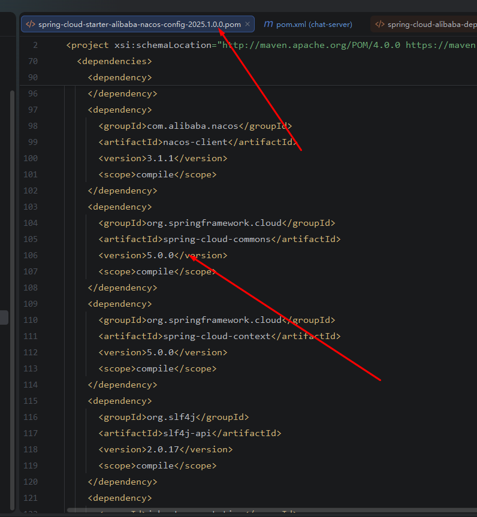
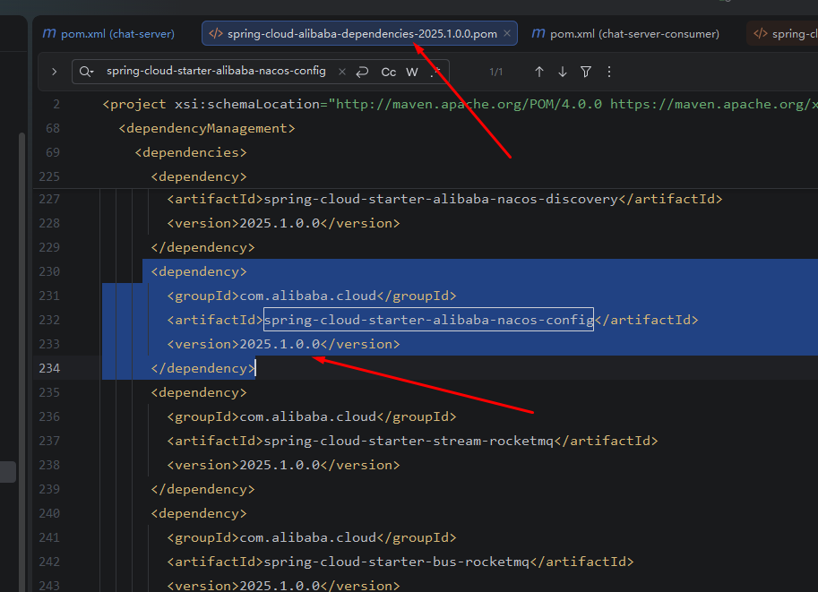
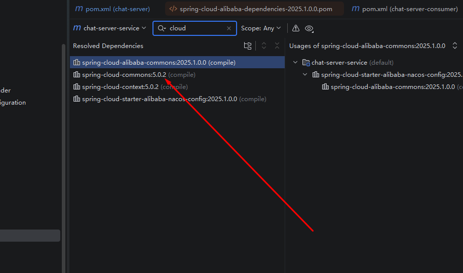
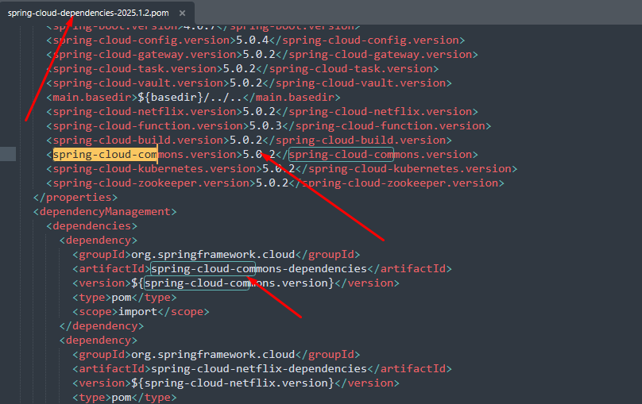
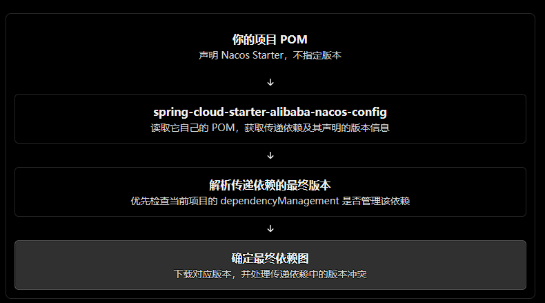

# Maven是如何确定最终依赖的版本
> 在开发的过程中我在子module的pom里面 有如下声明
```
        <!-- Nacos 配置中心 -->
        <dependency>
            <groupId>com.alibaba.cloud</groupId>
            <artifactId>spring-cloud-starter-alibaba-nacos-config</artifactId>
        </dependency>

```
> 这个依赖点进去本身也是一个pom里面有一堆依赖，其中就有spring-cloud-commons

> 这里我们可以看到spring-cloud-commons的版本是5.0.0

>回到父pom中
```
 <properties>
        <java.version>25</java.version>
        <spring-cloud-alibaba.version>2025.1.0.0</spring-cloud-alibaba.version>
        <spring-cloud.version>2025.1.2</spring-cloud.version>
    </properties>

<dependencyManagement>
        <dependencies>
            <dependency>
                <groupId>com.alibaba.cloud</groupId>
                <artifactId>spring-cloud-alibaba-dependencies</artifactId>
                <version>${spring-cloud-alibaba.version}</version>
                <type>pom</type>
                <scope>import</scope>
            </dependency>

            <!-- Spring Cloud -->
            <dependency>
                <groupId>org.springframework.cloud</groupId>
                <artifactId>spring-cloud-dependencies</artifactId>
                <version>${spring-cloud.version}</version>
                <type>pom</type>
                <scope>import</scope>
            </dependency>
<dependencyManagement>
```
> 我们知道在pom依赖里面如果没有声明版本 会从dependencyManagement里面去找 所以我们可以知道 spring-cloud-starter-alibaba-nacos-config的版本在spring-cloud-alibaba-dependencies这个关联的pom里面对应的版本是 



>但是最终项目的依赖版本spring-cloud-commons却是


> 明明5.0.0 怎么变成5.0.2呢？

> Maven在进行版本管理时 如果没有明确声明依赖的版本 那么**会从dependencyManagement里面去找**, 如果是依赖下面还有依赖 且没有显示声明，那么**还会从dependencyManagement里面去找** 即：

- 当前项目pom的dependency声明的依赖对应的pom文件里面声明的依赖的版本（spring-cloud-commons:5.0.0)Maven不会立即采用
- 会继续从dependencyManagement里面去寻找对应的依赖是否存在而且是按照这里的顺序依次查找，找到了在进行返回。

>回到项目 我们在spring-cloud-dependencies的pom里面发现了spring-cloud-commons


## 总结

- 项目下的依赖中声明的依赖和可能的版本信息会提交给Maven， Maven自身的版本管理机制会去再次到dependencyManagement寻找对应的依赖的版本 如果找了就用，找不到就用给到的之前的版本