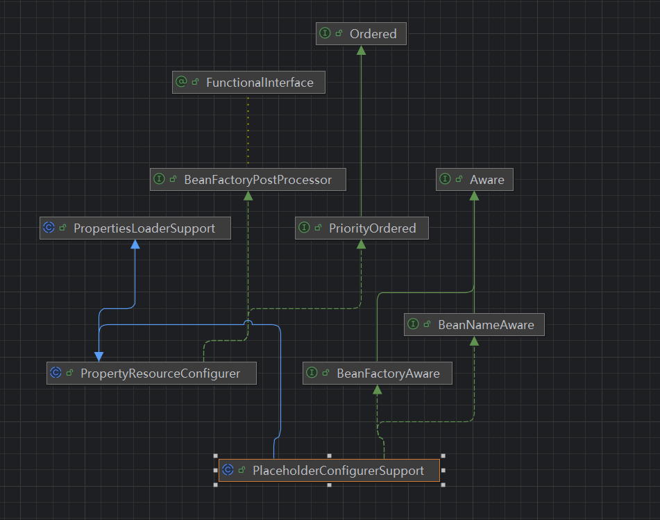
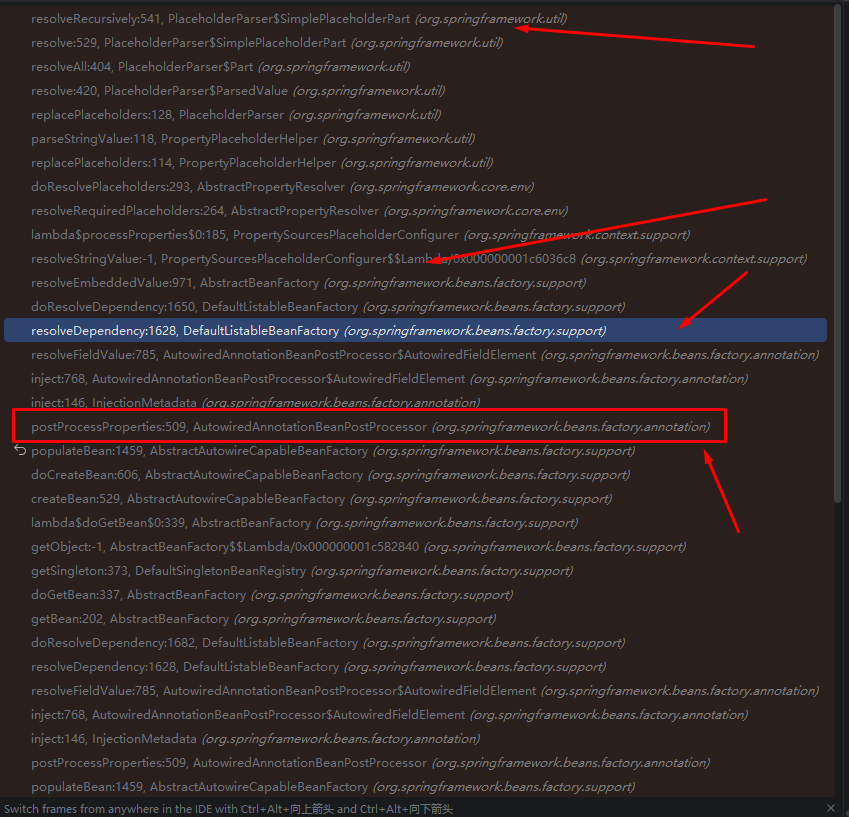

# @Value注解
> @Value 可以将配置文件里面的值设置到具体的bean里面，但是底层是如何流转的呢。

## Environment
> spring生态里面，不管是本地、服务器环境变量、远程配置等等，所有的配置内容都放在这个Environment里面，我们的@Value注解的值，也是从这个里面会获取的。


## AutowiredAnnotationBeanPostProcessor
> 在getBean方法的后半段，会有属性注入的逻辑（populateBean方法）
```
org.springframework.beans.factory.support.AbstractAutowireCapableBeanFactory#populateBean
if (hasInstantiationAwareBeanPostProcessors()) {
			if (pvs == null) {
				pvs = mbd.getPropertyValues();
			}
			for (InstantiationAwareBeanPostProcessor bp : getBeanPostProcessorCache().instantiationAware) {
				PropertyValues pvsToUse = bp.postProcessProperties(pvs, bw.getWrappedInstance(), beanName);
				if (pvsToUse == null) {
					return;
				}
				pvs = pvsToUse;
			}
		}
```
> 这里会触发 AutowiredAnnotationBeanPostProcessor的方法调用将对应的注解属性设置进去对应的配置值。

## 具体怎么设置的？
### StringValueResolver
> 在refresh方法里面有这么一个方法调用 **org.springframework.context.support.AbstractApplicationContext#finishBeanFactoryInitialization** 里面有个Lambel方法注入
```
org.springframework.context.support.AbstractApplicationContext#finishBeanFactoryInitialization
	// Register a default embedded value resolver if no BeanFactoryPostProcessor
		// (such as a PropertySourcesPlaceholderConfigurer bean) registered any before:
		// at this point, primarily for resolution in annotation attribute values.
		if (!beanFactory.hasEmbeddedValueResolver()) {
			beanFactory.addEmbeddedValueResolver(strVal -> getEnvironment().resolvePlaceholders(strVal));
		}
```
这里这个StringValueResolver就和Environment联系起来了，到这都是gpt告诉我的，但我本地代码代码是springboot4.x,这个代码压根不执行，真正执行的是下面这个
```
PropertySourcesPlaceholderConfigurer.processProperties
{
StringValueResolver valueResolver = strVal -> {
			String resolved = (this.ignoreUnresolvablePlaceholders ?
					propertyResolver.resolvePlaceholders(strVal) :
					propertyResolver.resolveRequiredPlaceholders(strVal));
			if (this.trimValues) {
				resolved = resolved.trim();
			}
			return (resolved.equals(this.nullValue) ? null : resolved);
		};


        doProcessProperties(beanFactoryToProcess, valueResolver);
}

protected void doProcessProperties(ConfigurableListableBeanFactory beanFactoryToProcess,
			StringValueResolver valueResolver) {

		BeanDefinitionVisitor visitor = new BeanDefinitionVisitor(valueResolver);

		String[] beanNames = beanFactoryToProcess.getBeanDefinitionNames();
		for (String curName : beanNames) {
			// Check that we're not parsing our own bean definition,
			// to avoid failing on unresolvable placeholders in properties file locations.
			if (!(curName.equals(this.beanName) && beanFactoryToProcess.equals(this.beanFactory))) {
				BeanDefinition bd = beanFactoryToProcess.getBeanDefinition(curName);
				try {
					visitor.visitBeanDefinition(bd);
				}
				catch (Exception ex) {
					throw new BeanDefinitionStoreException(bd.getResourceDescription(), curName, ex.getMessage(), ex);
				}
			}
		}

		// Resolve placeholders in alias target names and aliases as well.
		beanFactoryToProcess.resolveAliases(valueResolver);

		// Resolve placeholders in embedded values such as annotation attributes.
		beanFactoryToProcess.addEmbeddedValueResolver(valueResolver);  //  这里塞了个处理的方法 在外层我们看到也是lambel的写法
	}

```

> 可以看到这个类实现了BeanFactoryPostProcesssor接口，在refresh方法里面会被调用为工厂添加一个StringValueResolver 
```
@Override
	public void postProcessBeanFactory(ConfigurableListableBeanFactory beanFactory) throws BeansException {
		try {
			Properties mergedProps = mergeProperties();

			// Convert the merged properties, if necessary.
			convertProperties(mergedProps);

			// Let the subclass process the properties.
			processProperties(beanFactory, mergedProps);
		}
		catch (IOException ex) {
			throw new BeanInitializationException("Could not load properties: " + ex.getMessage(), ex);
		}
	}
```
> 所以在获取属性的时候实际去找配置的是这两行代码

```
PropertySourcesPlaceholderConfigurer.processProperties 

        StringValueResolver valueResolver = strVal -> {
			String resolved = (this.ignoreUnresolvablePlaceholders ?
					propertyResolver.resolvePlaceholders(strVal) :
					propertyResolver.resolveRequiredPlaceholders(strVal));
			if (this.trimValues) {
				resolved = resolved.trim();
			}
			return (resolved.equals(this.nullValue) ? null : resolved);
		};
```

## 真正的调用流程

```
 AutowiredAnnotationBeanPostProcessor.AutowiredFieldElement#inject
   AutowireCapableBeanFactory#resolveDependency
     AbstractBeanFactory#resolveEmbeddedValue
      上图中的lambel方法
       org.springframework.util.PlaceholderParser#replacePlaceholders   
        org.springframework.util.PlaceholderParser.SimplePlaceholderPart#resolve
```