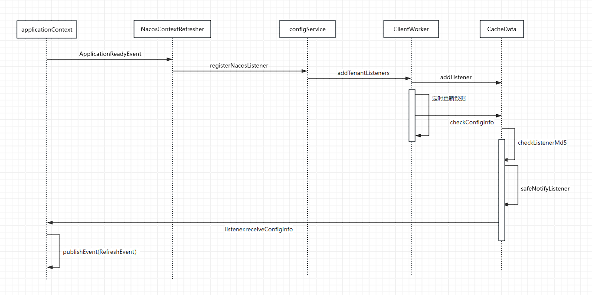
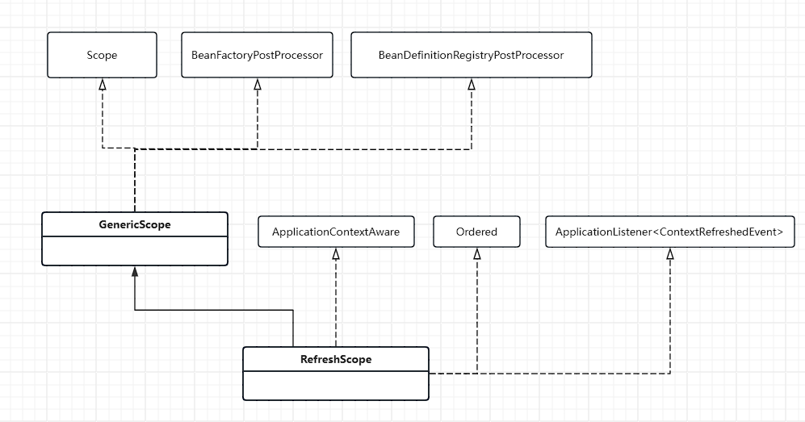

# SpringCloud感知Nacos配置变化
>srpingboot3以上使用了新的加载方式 采访的逻辑为springboot3之前的处理逻辑

> 在服务启动之后，我们会动态修改nacos里面的配置，比如下面的代码

```
@RestController
@RequestMapping("/config")
@RefreshScope
public class ConfigController {

    @Value("${useLocalCache:false}")
    private boolean useLocalCache;
    @RequestMapping("/get")
    public boolean get() {
        return useLocalCache;
    }
}
```
> 后续服务启动后，如果我们修改对应的配置useLocalCache 页面也会跟着变化

## Nacos和SpringCloud的分工
### Nacos侧通知配置发生了变更
> 依然从***nacos*** 包下的***spring.factories***文件入手
```
org.springframework.cloud.bootstrap.BootstrapConfiguration=\
org.springframework.cloud.alibaba.nacos.NacosConfigBootstrapConfiguration

org.springframework.boot.autoconfigure.EnableAutoConfiguration=\
org.springframework.cloud.alibaba.nacos.NacosConfigAutoConfiguration,\
org.springframework.cloud.alibaba.nacos.endpoint.NacosConfigEndpointAutoConfiguration
org.springframework.boot.diagnostics.FailureAnalyzer=\
org.springframework.cloud.alibaba.nacos.diagnostics.analyzer.NacosConnectionFailureAnalyzer
```

>_org.springframework.cloud.bootstrap.BootstrapConfiguration_ 这个我们在 [springcloud加载nacos配置](nacos-load.md) 中已经提到是在服务启动时从nacos拉取配置的

> _org.springframework.boot.autoconfigure.EnableAutoConfiguration_ 这个配置是 _springboot_ 在启动时自动装配会触发的类， nacos触发变更通知也是通过这个入口 加载的类为 _NacosConfigAutoConfiguration_
```
@Configuration
public class NacosConfigAutoConfiguration {
    
    ... 其他代码省略...

	@Bean
	public NacosContextRefresher nacosContextRefresher(
			NacosConfigProperties nacosConfigProperties,
			NacosRefreshProperties nacosRefreshProperties,
			NacosRefreshHistory refreshHistory) {
		return new NacosContextRefresher(nacosRefreshProperties, refreshHistory,
				nacosConfigProperties.configServiceInstance());
	}
}

```
### nacos通知变跟流程

- springboot在启动完毕后会发出一个 ApplicationReadyEvent 来通知监听的 **ApplicationListener** 这个事件会被 NacosContextRefresher 感知
  ``` 
  NacosContextRefresher implements ApplicationListener<ApplicationReadyEvent>,ApplicationContextAware
  ```

- NacosContextRefresher 会给nacos每个资源配置一个 **listener** 这个 **listener** 随着方法的调用最后会落在Nacos的CacheData上面
  > 补充说明  
  > 在nacos的资源管理中，对远程配置中心的数据管理使用 **dataId** （文件名 + 配置组）对应配置内容的方式存储在CacheData里面  
  在nacos的ConfigService实例化的时候会实例化一个 **ClientWorker**，**ClientWorker** 会在实例化方法里面启动一个定时任务（10s/次）来周期性的从配置中心拉取配置数据  
nacos在ConfigService中留了一个添加listener的方法，可以从外部添加对应的listener,用于对配置变更做出调整

- **ClientWorker** 的定时任务感知变更，调用从 **NacosContextRefresher** 设置进去的 **listener**，这个 **listener** 最终会让Spring的ApplicationContext发布RerfreshEvent事件

> 总的来说，其实就是在应用启动以后，Nacos会为每个资源配置一个listener, 在Nacos的周期性的监听中，如果发现变更，会通过这个配置的listener通知应用的上下文，这里只是发出了一个RerfreshEvent事件,然后nacos的活就结束了，剩下的工作便交由springCloud完成了。

### SpringCloud处理事件
#### RefreshScope注解
> 这个注解是SpringCloud在3.1版本的时候引入的 顾名思义他的意思就是说可刷新的
```
@Target({ ElementType.TYPE, ElementType.METHOD })
@Retention(RetentionPolicy.RUNTIME)
@Scope("refresh")
@Documented
public @interface RefreshScope {

	/**
	 * Alias for {@link Scope#proxyMode}.
	 * @see Scope#proxyMode()
	 * @return proxy mode
	 */
	@AliasFor(annotation = Scope.class)
	ScopedProxyMode proxyMode() default ScopedProxyMode.TARGET_CLASS;

}
```
>此外springcloud还有个类就叫RefreshScope

>我们知道spring的上下文里面有个很和核心的方法 **org.springframework.context.support.AbstractApplicationContext#refresh**  这个方法会准备 **BeanFactor** 配置各种BeanPostProcessors 然后完成Bean的实例化还会触发一些事件通知到第三方组件等等。

> 在 refresh方法中的invokeBeanFactoryPostProcessors中会触发方法 
```
public class GenericScope {
    ....

@Override
	public void postProcessBeanFactory(ConfigurableListableBeanFactory beanFactory) throws BeansException {
		this.beanFactory = beanFactory;
		beanFactory.registerScope(this.name, this);
		setSerializationId(beanFactory);
	}
    .....
}
```    
> 将RefreshScope添加到beanFactory中

>之后就是spring另一个很核心的方法 **org.springframework.beans.factory.support.AbstractBeanFactory#doGetBean** 这里是所有Bean完成实始化的地方 
```
// Create bean instance.
				if (mbd.isSingleton()) {
					...
				}

				else if (mbd.isPrototype()) {
					...
				}
				else {
					String scopeName = mbd.getScope();
					if (!StringUtils.hasLength(scopeName)) {
						throw new IllegalStateException("No scope name defined for bean '" + beanName + "'");
					}
					Scope scope = this.scopes.get(scopeName);
					if (scope == null) {
						throw new IllegalStateException("No Scope registered for scope name '" + scopeName + "'");
					}
					try {
						Object scopedInstance = scope.get(beanName, () -> {
							beforePrototypeCreation(beanName);
							try {
								return createBean(beanName, mbd, args);
							}
							finally {
								afterPrototypeCreation(beanName);
							}
						});
						beanInstance = getObjectForBeanInstance(scopedInstance, requiredType, name, beanName, mbd);
					}
					catch (IllegalStateException ex) {
						throw new ScopeNotActiveException(beanName, scopeName, ex);
					}
				}
			}
```
>我们回到RefreshScope看下scope.get这个方法
```
public Object get(String name, ObjectFactory<?> objectFactory) {
		BeanLifecycleWrapper value = this.cache.put(name, new BeanLifecycleWrapper(name, objectFactory));
		this.locks.putIfAbsent(name, new ReentrantReadWriteLock());
		try {
			return value.getBean();
		}
		catch (RuntimeException e) {
			this.errors.put(name, e);
			throw e;
		}
	}
```
> 这里用了一个cache缓存这些Bean 

>上面算是对 RefreshScope的一些知识补充 让我们回到 nacos 发送出RefreshEvent的后续处理上来  
> SpringCloud 只有一个监听类 **org.springframework.cloud.endpoint.event.RefreshEventListener**

```
@Override
	public void onApplicationEvent(ApplicationEvent event) {
		if (event instanceof ApplicationReadyEvent) {
			handle((ApplicationReadyEvent) event);
		}
		else if (event instanceof RefreshEvent) {
			handle((RefreshEvent) event);
		}
	}

	public void handle(ApplicationReadyEvent event) {
		this.ready.compareAndSet(false, true);
	}

	public void handle(RefreshEvent event) {
		if (this.ready.get()) { // don't handle events before app is ready
			log.debug("Event received " + event.getEventDesc());
			Set<String> keys = this.refresh.refresh();
			log.info("Refresh keys changed: " + keys);
		}
	}
```
然后最终会调用到 **org.springframework.cloud.context.scope.GenericScope#destroy()**
```
public void destroy() {
		List<Throwable> errors = new ArrayList<>();
		Collection<BeanLifecycleWrapper> wrappers = this.cache.clear();
		for (BeanLifecycleWrapper wrapper : wrappers) {
			try {
				Lock lock = this.locks.get(wrapper.getName()).writeLock();
				lock.lock();
				try {
					wrapper.destroy();
				}
				finally {
					lock.unlock();
				}
			}
			catch (RuntimeException e) {
				errors.add(e);
			}
		}
		if (!errors.isEmpty()) {
			throw wrapIfNecessary(errors.get(0));
		}
		this.errors.clear();
	}
```
> **这里Bean的destroy()到底干了些什么呢？**

这里Bean会被销毁，再次调用会触发新建，使用新的配置信息，构建新的Bean。